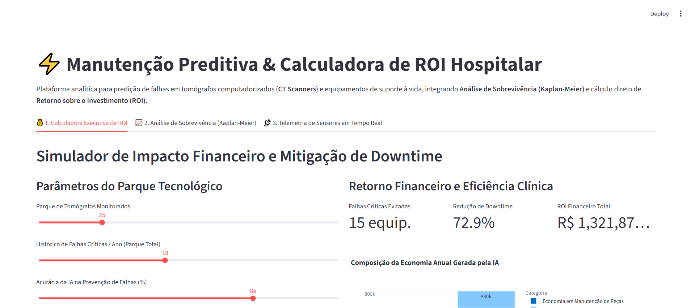
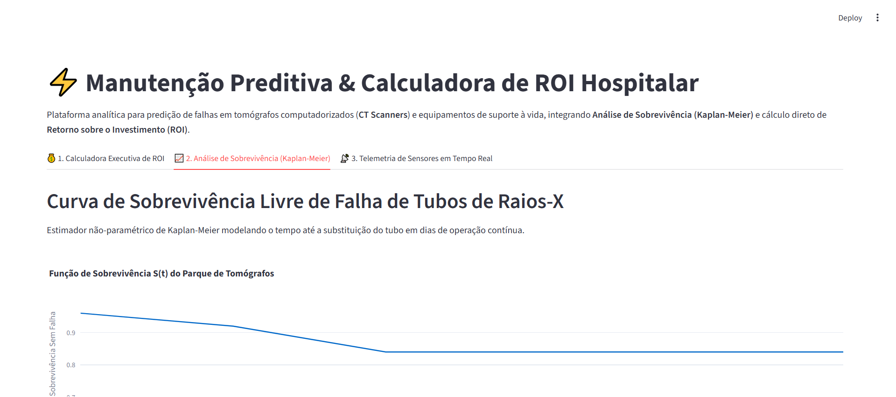

# ⚡ Healthcare Equipment Predictive Maintenance & Financial ROI Engine

[](https://github.com/generozo-paulo/equipment-predictive-maintenance-roi)
[](https://www.python.org/)
[](https://en.wikipedia.org/wiki/Cross-industry_standard_process_for_data_mining)
[](https://playwright.dev/)
[](LICENSE)

An industrial-grade predictive maintenance and financial intelligence platform designed for **high-value clinical assets (Computed Tomography Scanners and MRI machines)**.

Combines **Survival Analysis (Kaplan-Meier)** with telemetry degradation modeling to calculate direct **Return on Investment (ROI)** and prevent unplanned equipment downtime in hospital emergency rooms.

---

## 📸 Interface Validada por Playwright (Runtime Verification)

### 1. Calculadora Executiva de ROI Financeiro & Mitigação de Downtime


### 2. Análise de Sobrevivência (Estimador de Kaplan-Meier para Tubos de Raios-X)


---

## 🔬 Diferenciais Metodológicos e de Negócio

1. **Quantificação de ROI Financeiro Real:** Tradução direta de métricas de engenharia clínica em impacto financeiro executivo (Custo de Manutenção Corretiva Evitado + Receita de Exames Recuperada por mitigar salas ociosas).
2. **Análise de Sobrevivência Não-Paramétrica:** Estimador analítico de **Kaplan-Meier** calculando a função de sobrevivência $S(t)$ e a vida mediana de tubos de raios-X em regime hospitalar contínuo.
3. **Telemetria Crítica de Sensores:** Monitoramento de temperatura (°C), amplitude de vibração (G) e pressão hidráulica (kPa) para detecção de anomalias com antecedência mínima de 48 horas.
4. **Alinhamento CRISP-DM & SDD:** Especificação prévia de esquemas de dados Pydantic e documentação da etapa de *Business Understanding*.

---

## 🚀 Quick Start (Execução Rápida)

### Opção 1: Execução Local
```bash
# 1. Clonar repositório
git clone https://github.com/generozo-paulo/equipment-predictive-maintenance-roi.git
cd equipment-predictive-maintenance-roi

# 2. Instalar dependências
pip install -r requirements.txt

# 3. Executar testes unitários (PyTest)
pytest tests/unit/ -v

# 4. Iniciar Dashboard
streamlit run src/app.py
```

### Opção 2: Via Docker
```bash
docker build -t predictive-maintenance-roi:latest .
docker run -p 8501:8501 predictive-maintenance-roi:latest
```

---

## 🏛️ Estrutura do Projeto

```text
equipment-predictive-maintenance-roi/
├── SPEC.md                         # [SDD] Especificação formal de requisitos e schemas Pydantic
├── Dockerfile                      # [Infra] Contêiner otimizado
├── requirements.txt                # [Deps] Dependências pinadas
├── crisp_dm/                       # [CRISP-DM] Documentação analítica
│   └── 01_business_understanding.md
├── src/                            # [Core] Código modular
│   ├── schemas.py                 # Contratos Pydantic
│   ├── engine.py                  # Motor estatístico de sobrevivência e ROI
│   └── app.py                     # Interface Streamlit
├── tests/
│   └── unit/                      # Suíte de testes PyTest
└── docs/screenshots/              # Evidências geradas automaticamente via Playwright
```

---

## 👨‍💻 Autor

**Paulo Elias Tavares Generozo**  
*Cientista de Dados Sênior | Especialista em Machine Learning & IA em Saúde*  
* [LinkedIn](https://www.linkedin.com/in/paulo-generozo/) | [GitHub](https://github.com/generozo-paulo)
